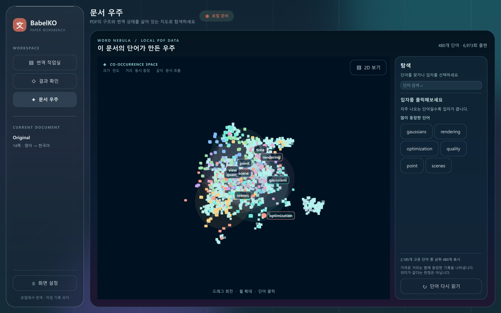
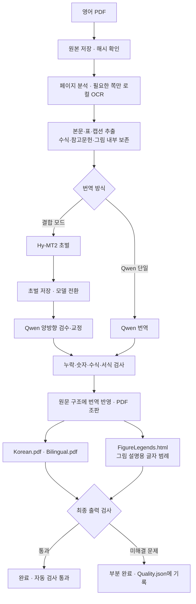

# BabelKO: 영어 PDF를 한국어 PDF로 번역

BabelKO는 논문과 책의 영어 PDF를 분석해 **한국어 PDF**와 **영한 대조본**을 만드는 Windows용 실험 프로그램입니다. [PDFMathTranslate-next](https://github.com/PDFMathTranslate/PDFMathTranslate-next)의 번역 인터페이스와 [BabelDOC](https://github.com/funstory-ai/BabelDOC)의 문서 분석·조판 엔진을 고정된 버전으로 결합했습니다. 기존 PaperTranslator와는 별도 앱이며 기존 설치나 작업 기록을 변경하지 않습니다.

번역 모델은 사용자의 PC에서 실행됩니다. **API 키나 유료 서비스는 필요하지 않습니다.** 첫 설치 시 프로그램·모델·글꼴 등을 내려받지만, 번역 작업 중 PDF 본문을 외부 서비스로 보내지 않습니다.

> **현재 단계:** 0.1 실험판입니다. 자동 검사에 통과한 PDF도 오역이나 누락이 없다고 보증할 수 없습니다. 중요한 문서는 영한 대조본으로 확인하세요.

## 먼저 알아둘 것

| 항목 | 현재 지원 |
| --- | --- |
| 입력 | 영어 PDF. 선택한 쪽만 번역하거나 전체 번역 가능 |
| 출력 | 한국어 PDF, 원문·번역을 나란히 놓은 대조본, 품질 보고서 |
| 스캔 | 필요한 쪽에 로컬 OCR 적용. 인식 결과는 원본 이미지와 다를 수 있음 |
| 모델 | Hy-MT2 초벌 + Qwen 검수·교정, 또는 Qwen 단일 모델 |
| 보존 | 수식·원본 쪽 대응·참고문헌 목록·확실히 인식한 그림 내부 글자 |
| 환경 | Windows 10/11 x64, NVIDIA CUDA 12 드라이버. 독립 실행 EXE와 CPU 전용 실행은 제공하지 않음 |

결합 모드에는 **24GB VRAM GPU를 권장**합니다. 두 모델 파일만 약 35GB이며, 설치 자산과 작업 공간을 포함해 사용자 드라이브에 **45GB 이상**을 확보하세요. Qwen 단일 모델 설치는 다운로드 약 16.8GB로 더 작지만, GPU가 작은 환경에서의 실행 가능 여부와 속도는 보장하지 않습니다.

## 설치하고 첫 PDF 번역하기

1. [Git](https://git-scm.com/downloads/win)과 [uv](https://docs.astral.sh/uv/getting-started/installation/)를 설치합니다. 설치하지 않았다면 PowerShell에서 아래 명령을 실행하고 **PowerShell을 새로 여세요**.

   ```powershell
   winget install --id Git.Git -e
   winget install --id astral-sh.uv -e
   ```

2. 저장소를 내려받고 설정 스크립트를 실행합니다. 첫 설정에는 인터넷 연결과 모델 다운로드 시간이 필요합니다. 별도로 Python이나 Ollama를 설치할 필요는 없습니다.

   ```powershell
   git clone https://github.com/zzzrichard0101/papertranslator-babelko.git
   cd papertranslator-babelko
   powershell -NoProfile -ExecutionPolicy Bypass -File .\scripts\setup.ps1
   powershell -NoProfile -ExecutionPolicy Bypass -File .\scripts\install.ps1
   powershell -NoProfile -ExecutionPolicy Bypass -File .\scripts\launch.ps1
   ```

3. 앱의 **번역 작업실**에서 PDF를 선택하고 번역 방식과 저장 위치를 확인한 뒤 **새 번역 시작**을 누릅니다. 원문 첫 쪽과 생성된 한국어 PDF의 첫 쪽을 작업실에서 미리 볼 수 있습니다. 이후에는 바탕화면의 **BabelKO 한국어 PDF 번역기 (실험판)** 바로가기로 실행할 수 있습니다.

왼쪽의 **화면 설정**에서는 페이퍼·나이트 테마, 포인트 색, 반투명 효과, 움직임, 미리보기 배치, 화면 밀도와 글자 크기를 조정할 수 있습니다. 반투명 패널은 Qt Quick의 `ShaderEffectSource`와 `MultiEffect`로 패널 뒤의 배경을 흐리게 처리합니다. 효과가 부담스럽다면 **반투명 패널**과 **부드러운 움직임**을 각각 끌 수 있습니다. 배경 움직임은 번역 작업 중 자동으로 멈춥니다. 화면 설정은 이 컴퓨터에만 저장되며 번역 모델이나 결과 PDF의 조판에는 영향을 주지 않습니다.

왼쪽 **문서 우주**는 PDF의 단어를 페이지 그림 없이 3D 입자로 펼쳐 보여줍니다. 단어가 많이 나올수록 입자가 크고, 가까운 단어는 원문에서 함께 등장한 경향이 있습니다. 드래그로 회전하고 휠로 확대하며, 입자를 클릭하거나 검색하면 등장 횟수와 연관 단어를 확인할 수 있습니다. **2D 보기**로 전환할 수도 있습니다. 분석은 로컬 PDF 텍스트만 사용하며 번역 모델을 호출하지 않습니다. 거리는 단어의 의미가 같다는 판정이 아닙니다. 계산 방식과 스캔본의 한계는 [단어 우주 안내](docs/PARTICLE-ATLAS.md)에 정리했습니다.



결합 모드 대신 **Qwen 단일 모델만 설치**하려면 2단계에서 아래 설정 명령을 사용하세요. 앱에서도 번역 방식을 **Qwen 단일 모델**로 선택해야 합니다. 나중에 기본 `setup.ps1`을 다시 실행하면 결합 모드용 모델을 추가할 수 있습니다.

```powershell
powershell -NoProfile -ExecutionPolicy Bypass -File .\scripts\setup.ps1 -ModelMode qwen
```

설치기는 다운로드를 재개하고 파일 크기와 SHA-256을 확인합니다. 모델과 작업 데이터는 기본적으로 `%LOCALAPPDATA%\PaperTranslatorBabelKO`에 저장되며 Git 저장소에는 포함되지 않습니다.

### 명령줄로 실행

```powershell
New-Item -ItemType Directory -Force results | Out-Null
.\.venv\Scripts\python.exe scripts\translate.py input.pdf --output results --pages 1-5,9 --ocr auto --mode hybrid
```

`input.pdf`를 실제 PDF 경로로 바꾸고, 경로에 공백이 있으면 따옴표로 묶으세요. `--output` 폴더는 미리 만들어야 합니다. `--pages`는 PDF 파일의 **물리적 쪽 번호**이며 생략하면 전체를 처리합니다. `--mode qwen`은 단일 모델, `--mode auto`는 설치된 모델에 따라 방식을 선택합니다. `--ocr`은 `auto`, `off`, `force` 중에서 고를 수 있습니다.

## 결과물 읽기

| 파일 | 용도 |
| --- | --- |
| `Original.pdf` | 원본 PDF 사본. 대조본의 원문 면에도 이 파일의 쪽을 사용 |
| `Korean.pdf` | 한국어 조판본 |
| `Bilingual.pdf` | 왼쪽 원문, 오른쪽 한국어의 쪽별 대조본 |
| `Quality.json` | 자동 검사 결과, 처리 범위, 미해결 문제와 처리 기록 |
| `FigureLegends.html` | 인식된 그림과 그 아래에 배치한 한국어 범례 |
| `FigureLegends.json` | 그림 범례의 처리·실패 기록. 그림이 없어도 생성 |
| `FigureImages/` | 범례 HTML에 표시되는 원본 그림 PNG. 생성된 각 파일의 해시를 검사하며 손상 시 원본 PDF에서 다시 만듦 |

품질 검사를 통과하지 못한 경우에도 읽어 볼 PDF가 만들어질 수 있습니다. 앱이 **부분 완료(`partial`)**로 표시하면 `Quality.json`에서 문제를 확인하세요. `partial`은 번역 완료나 의미 정확성 인증이 아닙니다. 취소하거나 실패한 작업은 앱의 **이 작업 다시 시작**으로 저장된 번역을 재사용할 수 있지만, 분석과 조판 일부는 다시 실행될 수 있습니다.

`Quality.json`의 `source_coverage`는 원문 PDF 텍스트층 및 이미 실행된 보조 OCR의 글을 번역 직전 문단과 대조한 **진단 기록**입니다. `suspected_missing_lines`와 `pixel_suspected_missing_rows`는 조사할 위치를 알려 주며, 현재는 오탐 검증 중이므로 완료 판정을 자동으로 바꾸지 않습니다. 0이라고 해서 스캔 이미지의 글자나 그림 내부 글자까지 모두 인식했다는 뜻은 아닙니다.

검수가 끝나기 전에 일부 쪽을 확인하려면 `scripts/export_preview.py --job "작업폴더" --pages "17,100"`을 사용할 수 있습니다. 이 확인본은 저장된 번역 후보만 사용하고 모델을 새로 호출하지 않으며, 정식 완료본으로 취급하지 않습니다.

## 번역은 어떻게 진행되나요?



그림 속 원문은 한국어 PDF에서 그대로 보존합니다. 범례 파일은 그림에 설명용 영문 글자가 인식된 경우에만 그 문구의 번역을 담습니다. 자동 검사에서 발견한 미해결 문제는 `Quality.json`에 기록합니다.

목차는 제목 한 단어에만 의존하지 않고, 반복되는 항목·오른쪽 쪽수의 정렬과 증가 순서를 함께 검사합니다. 스캔 OCR이 일반 글자를 수식으로 감싼 경우에도 글자만 있는 범위를 복구해 분리하고, 실제 수식은 보존합니다. 분리 중 글자가 빠지면 원본 글자를 재결합하고, 구조를 안전하게 복구할 수 없으면 해당 문단을 원래 상태로 되돌립니다. 탐지한 목차 항목 중 분리되지 않은 항목은 `Quality.json`의 `toc_structure`와 검사 문제로 남겨 완료 판정을 막습니다. 이 과정은 프로그램 안에서 자동으로 실행되며 PDF별 수동 수정에 의존하지 않습니다.

OCR을 거친 **색인 페이지**가 확실히 식별되면 한국어 PDF에서 해당 쪽을 원본 이미지로 복원합니다. OCR 글자층이 원본 이미지에 겹치는 일을 막기 위한 처리이며, 색인은 번역하지 않습니다. 복원한 쪽은 `Quality.json`의 `restored_original_index_pages`에 기록하고, 실험용 위치 검사에서는 원본과 출력의 픽셀이 정확히 같을 때만 통과시킵니다. 기존 완료 작업도 저장된 PDF를 사용해 복원할 수 있습니다.

### 모델은 어디까지 하고, 파이프라인은 무엇을 하나요?

여기서 **모델**은 Hy-MT2와 Qwen 같은 *번역용 언어 모델*을 뜻합니다. 모델이 번역문을 쓰고 검토 의견을 냅니다. **파이프라인**은 PDF를 읽고 번역 대상을 정하며, 모델에 보낼 입력·검사 기준·재시도를 관리하고 결과를 조판합니다. 문서 분석에는 BabelDOC의 배치 인식 모델과 로컬 OCR도 쓰이지만, 이들은 한국어 문장을 만드는 번역 모델과 역할이 다릅니다.

| 작업 | 번역 모델의 역할 | 파이프라인의 역할 |
| --- | --- | --- |
| PDF 읽기 | PDF의 칼럼과 좌표를 직접 정하지 않음 | 쪽·칼럼·문단·표·그림을 분석하고 필요한 쪽만 OCR. 원본과 해시 보존 |
| 번역할 내용 선택 | 전달받은 문장과 문맥을 사용 | 본문·캡션을 보내고, 수식·서식 자리표시자·식별한 참고문헌과 확실히 인식한 그림 내부 글자를 보호 |
| 한국어 문장 작성 | Hy-MT2가 초벌, Qwen이 검수·교정. 단일 모드에서는 Qwen이 번역 | 초벌 저장 후 모델 전환, 입력 분할·재시도·체크포인트 관리 |
| 번역 검수 | 결합 모드의 Qwen이 원문과 번역의 의미 차이를 찾고 수정을 제안 | 근거 구절과 응답 형식을 확인하고 숫자·부호·수식·서식·누락을 검사. 미해결 항목 기록 |
| PDF 만들기 | 글자의 최종 위치나 완료 상태를 직접 정하지 않음 | 원문 구조에 번역을 적용하고 한국어 PDF·대조본·그림 범례를 생성한 뒤 출력 검사 |

예를 들어 **2단 논문에 그림과 “Figure 2” 캡션이 있다면**, 파이프라인이 읽기 순서와 그림 경계를 찾고 그림 안의 원문을 보존합니다. 모델은 본문과 캡션의 한국어 문장을 만듭니다. 파이프라인은 “2” 같은 번호가 유지됐는지 확인하고 번역을 해당 쪽에 조판합니다. 그림 속 설명용 글자가 확실히 인식되면 모델이 그 문구를 번역하고, 파이프라인이 PDF 그림을 건드리지 않은 채 `FigureLegends.html`의 원본 그림 아래에 한글 범례를 붙입니다. 숫자 눈금·수식·패널 기호는 범례 번역에서 제외합니다.

결합 모드는 **Hy-MT2 30B-A3B 초벌 → 저장 → Qwen3.8 27B 검수·교정** 순서로 실행하며 두 모델을 동시에 GPU에 올리지 않습니다. Qwen 단일 모드에는 결합 모드의 양방향 의미 검수가 없습니다. 모델의 검토 의견을 파이프라인이 검사하더라도 의미 정확성을 완전히 증명할 수는 없습니다.

중복 작업을 줄이기 위해 완료한 OCR 쪽, 원문·설정에 묶인 문서 분석, 검증된 번역 체크포인트를 재사용합니다. 숫자가 모두 남아 있어도 단위나 명시된 집단·변수의 값이 서로 바뀌거나, 정의된 전문용어의 괄호 속 약어가 다른 약어로 바뀌면 후보 번역을 다시 검사합니다. 문맥상 의미가 같은지까지 이 규칙만으로 판정하지는 않습니다. `performance.json`에서 단계별 시간과 모델 요청 수를 확인할 수 있습니다. 속도는 문서 구조, 스캔 상태, 모델·GPU, 캐시 적중 여부에 따라 크게 달라집니다.

## 지금까지의 한계

- **정확도 보증은 없습니다.** 숫자·서식 검사와 모델의 재검수만으로 원문 의미를 완전히 증명할 수 없습니다. 결합 모드의 교정과 검수에도 같은 로컬 Qwen 모델이 관여하므로 독립적인 전문가 검토를 대체하지 않습니다. Qwen 단일 모드는 의미 대조 범위가 더 좁습니다.
- **OCR과 읽기 순서가 틀릴 수 있습니다.** 저해상도 스캔, 손글씨, 복잡한 배경, 다단 구성, 겹친 표·그림에서는 글자를 놓치거나 순서를 잘못 묶을 수 있습니다. OCR 입력의 한국어 조판은 원본 스캔의 글꼴·배치와 같지 않을 수 있습니다.
- **자동 복구에는 관측 가능한 원문이 필요합니다.** OCR이 글자를 아예 읽지 못했거나 목차·표·수식의 경계 자체를 잘못 판단하면, 원본 PDF만으로 정답을 확정할 수 없습니다. 이때 안전하지 않은 재구성을 강행하지 않고 부분 완료로 기록합니다.
- **원본과 똑같은 조판은 어렵습니다.** 한국어 문장 길이와 글꼴이 달라 표 셀, 주석, 특수 수식, 회전 페이지에서 위치나 줄바꿈이 달라질 수 있습니다. 대조본은 같은 원문 쪽과 번역 쪽을 대응시키지만 모든 요소의 1:1 위치 일치를 보증하지 않습니다.
- **그림 범례는 제한적입니다.** 그림 경계가 확실히 인식될 때만 내부 글자를 안전하게 보존·분류합니다. 이미지 픽셀에 박힌 글자나 인식되지 않은 도식의 글자를 모두 찾아 번역하지는 못합니다. 범례 실패는 보고서에 남기고 완료 판정을 막습니다.
- **참고문헌 판별도 완전하지 않습니다.** 비정형 서지 목록은 참고문헌으로 식별하지 못하거나 본문과 혼동할 수 있습니다.
- **속도와 지원 환경이 제한됩니다.** 긴 문서의 OCR·모델 검수·PDF 조판은 오래 걸릴 수 있습니다. Windows/NVIDIA 중심의 소스 설치 방식이며 독립 실행 EXE, CPU 전용 실행, 모든 GPU 환경 지원은 제공하지 않습니다. 기존 앱의 무료 API·Obsidian 등 모든 기능도 이식되지 않았습니다.
- **입력 제한이 있습니다.** 500MB를 넘거나 2,000쪽을 넘는 PDF, 암호로 보호된 PDF는 현재 작업을 시작할 수 없습니다.

공개 자료와 합성 PDF로 여러 칼럼, 표, 수식, 인쇄체 스캔, 가로·회전 쪽을 검사했지만 **모든 PDF 형식과 모든 쪽을 검증한 것은 아닙니다**. 테스트에서 모델 응답을 모방한 합성 검사와 실제 모델의 번역 품질 평가는 구분해야 합니다.

## 문제 해결과 개발 문서

- 설치 다운로드가 끊기면 같은 `setup.ps1` 명령을 다시 실행하세요. 모델 확인은 `.\.venv\Scripts\python.exe scripts\download_models.py --verify-only`로 할 수 있습니다. Qwen만 설치했다면 `--mode qwen`을 추가합니다.
- `로컬 엔진 시작 실패`가 뜨면 해당 작업 폴더의 `engine-*.log`를 확인하세요. 다른 `llama-server.exe`가 같은 자원을 사용 중인지도 확인합니다.
- 구현 순서와 통과 기준은 [범용 PDF 검증·복구 워크플로우](docs/GENERALIZED-PDF-WORKFLOW.md)에 있습니다. 구현 세부 사항은 [아키텍처](docs/ARCHITECTURE.txt), [성능 점검](docs/PERFORMANCE.txt), [OCR 입력 검증](docs/OCR-AUDIT.txt), [실험 파이프라인](docs/EXPERIMENTAL-PIPELINE.txt), [개발 기록](DEVELOPMENT.txt)에 있습니다. **새 파이프라인 실험**은 결합 모드에서만 선택할 수 있으며 기본 설정은 아닙니다.

개발 검사는 `uv run pytest -q`, `uv run python scripts/integration.py`, `uv run python scripts/integration.py --mode hybrid`로 실행합니다. 실제 모델 의미 평가와 공개 PDF 코퍼스 도구는 `scripts/evaluate_meaning.py`, `scripts/accuracy_corpus.py`에 있습니다. 실제 논문 원문에 대한 세 방식의 블라인드 비교 절차와 독립 검토의 요건은 [번역 정확도 평가 절차](docs/ACCURACY-EVALUATION.md)를 참고하세요. 개발용 원문·결과는 로컬 `test_vault/`에만 저장합니다.

라이선스는 **AGPL-3.0-only**입니다. 상위 프로젝트, 모델 가중치와 글꼴의 라이선스·출처는 [NOTICE.txt](NOTICE.txt), [LICENSE](LICENSE), [upstream.lock.json](upstream.lock.json)을 확인하세요.
